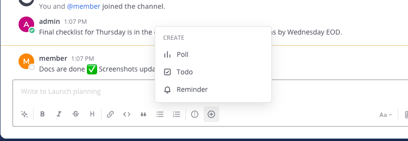
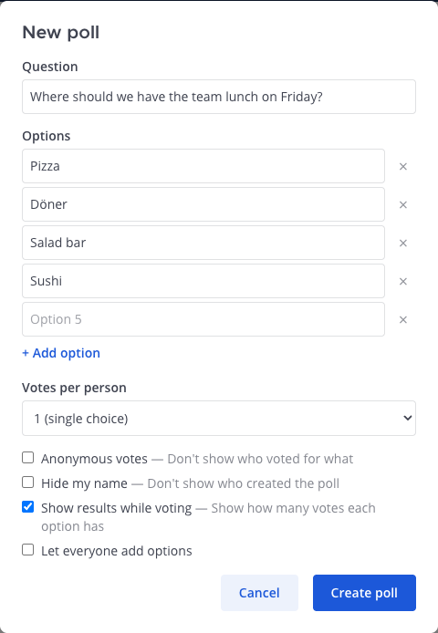
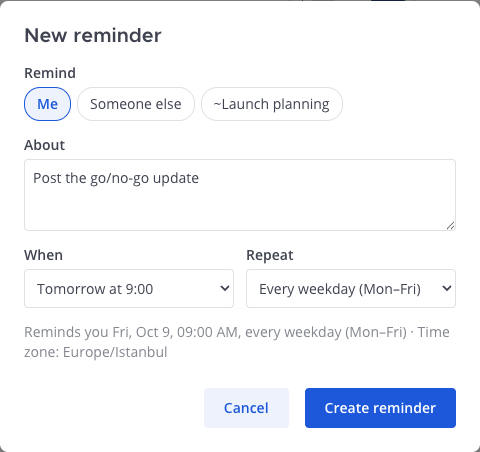
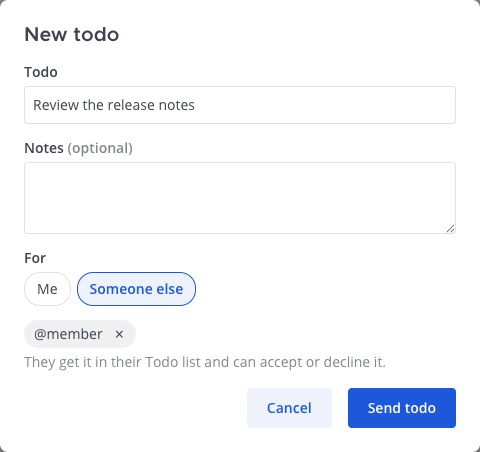
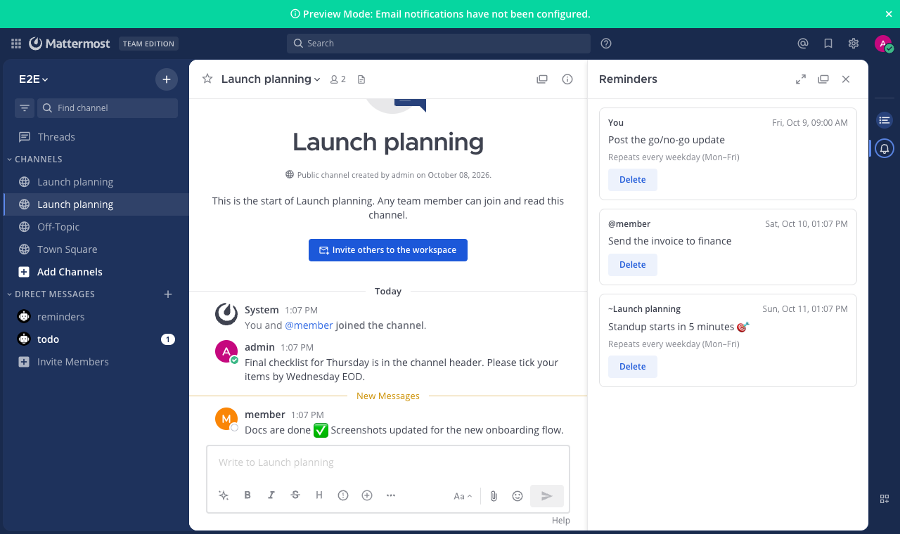

# Quick Create for Mattermost

Create **polls**, **todos** and **reminders** from a button in the message box — no slash
commands to remember. One ⊕ button, three short dialogs.



## Features

- **⊕ in every message box** (channel and thread reply) → **Poll**, **Todo** or **Reminder**.
- **Poll**: a question and **as many options as you need** (+ Add option, up to 20), votes
  per person, anonymous votes, hide the creator, show results while voting, let everyone add
  options. The poll itself is a [Matterpoll](https://github.com/matterpoll/matterpoll) poll, so
  voting and results work exactly as before.
- **Todo** adds to your list, or sends it to a colleague, in the
  [Todo plugin](https://github.com/mattermost-community/mattermost-plugin-todo) — with optional
  notes and a people picker.
- **Reminder** — built in, no other plugin needed:
  - remind **yourself**, **someone else**, or **the current channel**;
  - **In 20 minutes**, **In 1 hour**, **Tomorrow at 9:00**, **Next Monday at 9:00** or any date
    and time, in the time zone from your Mattermost profile;
  - **repeat** every day, every weekday (Mon–Fri) or every week — at the same local time, also
    across daylight-saving changes;
  - personal reminders arrive as a DM from the *Reminders* bot with **Snooze 20 min**,
    **Snooze 1 hour**, **Tomorrow 9:00** and **Done**; channel reminders are posted in the channel;
  - a **Reminders** panel (bell icon in the app bar) lists every reminder you've set, with
    **Delete**.

| Poll | Reminder | Todo |
|---|---|---|
|  |  |  |




## Requirements

- Mattermost **10.11** or later. Tested on **11.7** and **12.0** with the same build.
- For **Poll**: Matterpoll (tested with 1.9). For **Todo**: the Todo plugin (tested with 0.7.1).
  Without them, Reminder still works and the other two show a short "ask your admin" note.

Tip: Mattermost's built-in **Remind** (in every message's ⋯ menu) covers "remind me about this
message"; Quick Create covers free-text, repeating and channel reminders.

## Install

1. Download `dev.patika.quick-create-<version>.tar.gz` from the
   [latest release](https://github.com/PatikaDev/mattermost-plugin-quick-create/releases/latest)
   (`SHA256SUMS` is attached for verification).
2. **System Console → Plugins → Plugin Management → Upload Plugin**, choose the file, then
   **Enable**. Plugin uploads must be allowed (`PluginSettings.EnableUploads`).

Or with `mmctl`:

```bash
mmctl plugin add dev.patika.quick-create-<version>.tar.gz
mmctl plugin enable dev.patika.quick-create
```

Users may need to reload the app (Ctrl/Cmd + R) to see the ⊕ button. There is nothing to
configure.

### Good to know

- Reminders are delivered by a job that runs **once a minute**, so they arrive within a minute
  of the chosen time. If the server was down, a missed one-off reminder arrives as soon as it is
  back; a repeating one is delivered once and then continues on schedule (no burst).
- Just before delivering, the plugin checks again that the creator is active, the recipient is
  active, and (for channel reminders) that the creator can still post there. If not, the
  reminder is removed and its creator gets a DM with the reason and the text.
- Limits: **200** reminders per person, **4,000** characters, at least **30 seconds** and at
  most **one year** ahead. Reminders go to people only, not bots; channel reminders work in
  public and private channels.
- Mobile apps don't show plugin buttons, so reminders are created from the web or desktop app;
  they arrive on every device as usual.

## How it works

The webapp adds the button, the dialogs and the panel. **Poll** turns the dialog into
Matterpoll's `/poll "Question" "Option 1" "Option 2" … --settings` command and runs it for you
(Matterpoll's own dialog is limited to three options; its command is not). **Todo** calls the Todo plugin's own
API. **Reminders** are stored in this plugin's key-value store; a cluster-safe job delivers due
reminders once a minute, claiming each one with a compare-and-set so it is delivered once even
with several app servers.

## Privacy

Reminders are stored on your own Mattermost server (the plugin's key-value store). The plugin
sends nothing anywhere else.

## Development

Requirements: Node 24.21.0 (see `.node-version`), Go (see `go.mod`), Docker for the
end-to-end tests.

```bash
go test -race ./server/...                         # server unit tests
cd webapp && npm ci
npm run lint && npm run check-types && npm test    # webapp unit tests
cd .. && make dist                                 # → dist/dev.patika.quick-create-<version>.tar.gz
```

End-to-end tests drive real Chrome against a throwaway Mattermost in Docker, with Matterpoll and
Todo installed, and wait for the real minute job (about 3 minutes in total):

```bash
cd e2e && npm ci && npx playwright install chrome
MM_VERSION=11.7.11 ./scripts/start-server.sh       # or 12.0.0, …
npx playwright test
npm run server:stop
```

The webapp is built to run unchanged on React 17, 18 and 19 (the server's own React is used at
runtime). See [CONTRIBUTING.md](CONTRIBUTING.md).

Releases are cut by pushing a `v*` tag; CI builds the plugin and attaches it to a GitHub
Release.

## License

[Apache License 2.0](LICENSE). Built on the
[Mattermost plugin starter template](https://github.com/mattermost/mattermost-plugin-starter-template)
— see [NOTICE](NOTICE). Made by [Patika](https://patika.dev).
